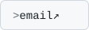

<picture><source media="(prefers-color-scheme: dark)" srcset="./assets/header-dark.svg" /></picture>

Hi! I'm Brisa. Nice to meet you. I study Computer Engineering at UBA in Buenos Aires and work as a freelance Design Engineer. I've always loved diving deep into how things work, bringing together thoughtful design and code.

I love talking about design, code, and creative side projects—if anything here catches your eye, come say hi.

<picture><source media="(prefers-color-scheme: dark)" srcset="./assets/stack-dark.svg" /></picture>

  <a href="mailto:contact@brisadsx.com"><picture><source media="(prefers-color-scheme: dark)" srcset="./assets/btn-email-dark.svg" /></picture></a>&nbsp;
  <a href="https://www.linkedin.com/in/brisa-gabriela/"><picture><source media="(prefers-color-scheme: dark)" srcset="./assets/btn-linkedin-dark.svg" /></picture></a>

<picture><source media="(prefers-color-scheme: dark)" srcset="./assets/footer-dark.svg" /></picture>
