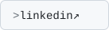

<picture><source media="(prefers-color-scheme: dark)" srcset="./assets/header-dark.svg" /></picture>

I am a Computer Engineering student at University of Buenos Aires, currently building my path in the tech world. As someone who has never stopped learning and investigating things until getting to the bottom of them, I am expanding my knowledge in both front-end and back-end development. I love creating things that are productive, innovative, and data-driven.

<picture><source media="(prefers-color-scheme: dark)" srcset="./assets/stack-dark.svg" /></picture>

  <a href="mailto:contact@brisadsx.com"><picture><source media="(prefers-color-scheme: dark)" srcset="./assets/btn-email-dark.svg" /></picture></a>&nbsp;
  <a href="https://www.linkedin.com/in/brisa-gabriela/"><picture><source media="(prefers-color-scheme: dark)" srcset="./assets/btn-linkedin-dark.svg" /></picture></a>

<picture><source media="(prefers-color-scheme: dark)" srcset="./assets/footer-dark.svg" /></picture>